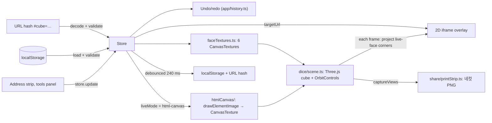

# Cube Site

Decorate a 3D cube that holds a live website, then share it as a link or a four-frame photo strip (네컷).

- Live: https://html-in-canvas-edu-app.vercel.app (Vercel) · https://cskwork.github.io/cube-site/ (GitHub Pages)
- Stack: TypeScript, Three.js 0.171, Vite 6, Vitest 2 + happy-dom. Static site, no backend.

## Problem

Showing off a website usually means a flat screenshot. Cube Site puts the real, clickable site on one face of a 3D cube and lets you theme the other five faces with presets, stickers and text. Sites that refuse to be embedded can still be shown as a painted "style card". The whole result travels in a single URL, with no server or account, and can also be printed as a 600×1800 photo strip. It also serves as a working, capability-gated example of Chrome's experimental HTML-in-Canvas API (`drawElementImage`).

## Architecture



Details, failure handling and module table: [docs/architecture.md](docs/architecture.md).

## Key technical decisions

- **2D iframe overlay instead of `CSS3DRenderer`.** Chrome's iframe hit-testing under CSS 3D transforms was unreliable, so `src/dice/scene.ts` projects the live face's corners every frame and places a flat iframe over them, hiding it when the face turns away. [ADR 0001](docs/adr/0001-2d-iframe-overlay-over-css3d.md)
- **HTML-in-Canvas behind one adapter.** `src/htmlCanvas/adapter.ts` feature-detects `drawElementImage` and returns `null` when it is missing; `src/htmlCanvas/liveFace.ts` tears down to the painted face on any error. The default mode stays the iframe. [ADR 0002](docs/adr/0002-html-in-canvas-behind-adapter.md)
- **State in the URL hash, validated at every entry.** `src/share/hash.ts` uses short keys to keep a decorated cube under 2 KB; `validate()` in `src/app/state.ts` repairs face indices and colors and only accepts `http(s)` target URLs. [ADR 0003](docs/adr/0003-url-hash-state-with-validation.md)
- **Undo by edit bursts.** `src/app/history.ts` snapshots at the start of a burst (600 ms idle), so one Ctrl/⌘ Z undoes a whole slider drag; selecting a face is not an undo step.
- **Camera views as pure math.** `src/dice/views.ts` computes front/overview/orbit positions without WebGL, so they are unit-tested and reused by the photo-strip capture.

## Run locally

```bash
git clone https://github.com/cskwork/cube-site.git
cd cube-site
npm ci
cp .env.example .env     # optional — TARGET_URL etc. are runtime-editable
npm run dev              # http://localhost:5173
```

```bash
npm run typecheck        # tsc --noEmit
npm run test             # vitest run
npm run build            # → dist/
npm run verify           # typecheck + test + build
```

## Testing

`npm run test` on 2026-10-28 (Node 22.19.0, local): **8 files, 48 passed, 0 failed, 0 skipped.** `npm run typecheck` and `npm run build` (also with `BASE_PATH=/cube-site/`) passed.

| File | Covers |
|---|---|
| `src/app/state.test.ts` | `validate()`: face-index clamps, missing faces/colors, CSS-injection accent, immutability |
| `src/app/history.test.ts` | undo/redo, burst grouping, face selection ignored, stack limit |
| `src/share/hash.test.ts` | codec roundtrip, 2 KB budget, legacy format, unsafe `targetUrl` |
| `src/share/printStrip.test.ts` | strip layout, four capture angles, file name, host label |
| `src/dice/views.test.ts` | camera view math |
| `src/htmlCanvas/adapter.test.ts` | native/fallback detection with a stubbed `drawElementImage` |
| `src/ui/stage.test.ts` | URL normalization |
| `src/ui/tools.test.ts` | panel keeps the same slider/text field during edits, rebuilds on external change |

WebGL rendering, the iframe overlay and real `drawElementImage` painting are not covered by automated tests. CI (`.github/workflows/ci.yml`) runs typecheck, tests and a Pages-path build on every pull request and push to `main`.

## Features

- **Live site on a face.** One face of the cube is a real `<iframe>`, screen-tracked to the live face each frame over the Three.js WebGL canvas. You click buttons, scroll, type, submit forms — through the cube. (A 2D overlay was chosen over `CSS3DRenderer` because Chrome's CSS-3D iframe hit-testing is unreliable.)
- **Three live-face modes.** `실제 사이트` (interactive iframe, default), `스타일 카드` (a Canvas2D site-preview card for sites that block framing), and `HTML-in-Canvas` (experimental — see below).
- **Decorate the other 5 faces.** 5 trend presets (Y2K Cyber, Frutiger Aero, Soft Pastel, Holographic, Bento), color/glow/hue/radius sliders, 24 emoji stickers, per-face text imprint.
- **Swap any URL at runtime.** Paste any URL into the address strip above the viewfinder, hit 띄우기, and the cube becomes that site. A loading state shows while it loads, with a hint if the site blocks framing.
- **Share via URL hash.** The decoration state AND the active URL serialize to a compact base64url hash. Copy the link, paste in another tab/device, identical cube reappears.
- **네컷 출력.** Print the decorated cube as a four-frame photo-booth strip (600×1800 PNG). Save it, or send it with the Web Share API where supported.
- **Undo / redo.** Every edit can be undone (Ctrl/⌘ Z, Shift+Ctrl/⌘ Z, or the footer keys). Reset is undoable, so it no longer asks for confirmation.
- **View keys + keyboard orbit.** 사이트 정면 / 둘러보기 / turn left / turn right, plus arrow keys, Home and End on the focused cube, so rotating never requires a drag.
- **Pure static site.** Vite + TypeScript + Three.js. `npm run build` emits `dist/` that drops onto GitHub Pages / Vercel / Netlify / Cloudflare Pages / S3 with no backend.
- **Korean-first UI** following the [10 award-worthy web design rules](https://github.com/cskwork/web-design-10-rules) — tokens, 8pt rhythm, instant 5-second clarity, prefers-reduced-motion, WCAG-grade focus rings.

### How the HTML-in-Canvas mode works

Chrome's [HTML-in-Canvas](https://developer.chrome.com/blog/html-in-canvas-origin-trial) (WICG `drawElementImage`) lets you paint live DOM into a `<canvas>`. The `HTML-in-Canvas` live-face mode is a real implementation of it:

1. A hidden `<canvas layoutsubtree>` hosts a live HTML panel as its direct child ([`src/htmlCanvas/livePanel.ts`](src/htmlCanvas/livePanel.ts)).
2. On each `onpaint`, `ctx.drawElementImage(panel, 0, 0)` snapshots that DOM into the canvas ([`src/htmlCanvas/adapter.ts`](src/htmlCanvas/adapter.ts)).
3. That canvas backs a `THREE.CanvasTexture` mapped onto the rotating cube's live face ([`src/htmlCanvas/liveFace.ts`](src/htmlCanvas/liveFace.ts)) — so it's genuinely *HTML → canvas → WebGL*.

The adapter feature-detects `ctx.drawElementImage` (`detectMode()`); the status chip under the viewfinder ([`src/ui/stage.ts`](src/ui/stage.ts)) reports whether native mode is active, and the mode pill is disabled with an explanation when it isn't.

**This is an experimental, single-browser feature** — it runs only on Chromium 147+ with the `chrome://flags/#canvas-draw-element` flag, or Chrome 148–151 with an Origin-Trial token; never Firefox/Safari. So `실제 사이트` (iframe) is the honest cross-browser default, and the `HTML-in-Canvas` mode gracefully falls back to the iframe when unsupported.

## Source layout

```
src/
├── main.ts
├── app/
│   ├── bootstrap.ts        wires state, history, scene, stage chrome, tools, live-canvas
│   ├── state.ts            AppState + Store + localStorage + validate()
│   ├── state.test.ts
│   ├── history.ts          undo / redo stack (bursts of edits collapse)
│   └── history.test.ts
├── htmlCanvas/
│   ├── adapter.ts          drawElementImage detect + <canvas layoutsubtree> source
│   ├── adapter.test.ts
│   ├── livePanel.ts        the live DOM painted onto the face
│   └── liveFace.ts         drawElementImage → CanvasTexture → cube controller
├── dice/
│   ├── scene.ts            Three.js cube + 2D iframe overlay + view tweens + capture
│   ├── views.ts            camera viewpoints (front / overview / orbit) as pure math
│   ├── views.test.ts
│   └── faceTextures.ts     per-face CanvasTexture painter (+ live preview card)
├── share/
│   ├── hash.ts             state ↔ base64url URL-hash codec (validated)
│   ├── hash.test.ts
│   ├── printStrip.ts       네컷 four-angle photo strip composer
│   └── printStrip.test.ts
├── ui/
│   ├── tools.ts            step tabs + deco/imprint/share panels + footer
│   ├── tools.test.ts
│   ├── stage.ts            address strip, mode switch, view keys, loading, coach
│   ├── printPanel.ts       네컷 출력 section
│   ├── icons.ts            authored SVG icon set
│   └── toast.ts
├── util/dom.ts
└── styles/
    ├── tokens.css          design tokens (8pt rhythm, type scale, motion)
    ├── base.css            reset + reduced-motion
    ├── layout.css          2-pane shell (stage | tools)
    └── components.css      buttons, sliders, presets, mode pills
```


## Limitations and next steps

- **Cross-origin popups.** A target site's `target="_blank"` links or `window.open` calls cannot be redirected back into the cube iframe — by browser security spec, cross-origin documents can't be re-targeted from outside. For same-origin targets, the app injects `<base target="_self">` on load so internal nav stays in-cube.
- **X-Frame-Options.** Sites that serve `X-Frame-Options: DENY` or strict `Content-Security-Policy: frame-ancestors` will load blank. Switch the address strip's "스타일 카드" mode to hide the empty iframe and show the WebGL face decoration instead.
- **HTML-in-Canvas is experimental & Chromium-only.** The `HTML-in-Canvas` mode needs Chromium 147+ with `chrome://flags/#canvas-draw-element`, or an Origin-Trial token (trial runs ~M148–M151, 2026; it expires). Firefox/Safari are unsupported. The iframe/card modes need none of this and work everywhere.
- **Origin Trial on a real deploy.** GitHub Pages cannot send an `Origin-Trial` response header, so the only way to enable the OT in production is the `<meta http-equiv="origin-trial">` slot — set the `OT_TOKEN` repo secret (CI injects it via `%OT_TOKEN%`) with a token registered for `https://cskwork.github.io`. Note: `*.vercel.app` is on the Public Suffix List, so no wildcard Vercel token can be issued — use a custom domain (Vercel *can* set the `Origin-Trial` response header) or register per preview URL.

- **Next steps.** `validate()` does not range-check numeric fields (hue, glow, radius, sticker scale) yet. The production CSS is 506.70 kB (309.38 kB gzip) because Vite inlines 59 small Do Hyeon font subsets as base64; a lower `build.assetsInlineLimit` for fonts would shrink it. Rendering paths (WebGL, iframe overlay, real `drawElementImage`) have no browser tests.

## Deploy

### GitHub Pages (recommended for OSS)

The repo ships with [`.github/workflows/pages.yml`](.github/workflows/pages.yml). On every push to `main`:

1. The workflow runs typecheck + tests.
2. Builds with `BASE_PATH=/<repo-name>/`.
3. Publishes `dist/` to the `gh-pages` environment.

Enable Pages in repo Settings → Pages → Build and deployment → Source: **GitHub Actions**.

Optional repo secrets / variables:
- `OT_TOKEN` (secret) — Chrome HTML-in-Canvas Origin Trial token.
- `TARGET_URL` (variable) — default URL the cube loads on first visit.

### Vercel

```bash
npm i -g vercel
vercel --prod
```

Or click the GitHub → Vercel "Import Project" button — [`vercel.json`](vercel.json) is already wired (build `npm run build`, output `dist`, immutable asset caching).

Set `TARGET_URL` and `OT_TOKEN` as Vercel project env vars if you want non-default initial URL or to ship the OT meta tag.

### Netlify

```bash
npm i -g netlify-cli
netlify deploy --prod --dir=dist
```

### Cloudflare Pages

```bash
npm i -g wrangler
wrangler pages deploy dist --project-name=cube-site
```

### S3 + CloudFront

```bash
BUCKET=my-bucket DISTRIBUTION_ID=E123ABC ./deploy/s3.sh
```

The bundled `deploy/*.sh` scripts cover all four.

## Configuration

Everything is optional — the app boots with sane defaults and the address strip lets users override the URL at runtime.

| Env var | Default | Notes |
|---------|---------|-------|
| `TARGET_URL` | `https://example.com` | Default URL the cube loads. Runtime-overridable in the address strip. |
| `TARGET_NAME` | `Live Site` | Brand text shown in the styled "card" fallback mode. |
| `TARGET_TITLE` | `내 사이트,\n바로 입장` | Card mode hero title. |
| `TARGET_SUB` | `원하는 어떤 URL이든 큐브 안에 띄울 수 있어요.` | Card mode subline. |
| `TARGET_CHIPS` | `3D · HTML in Canvas · Vite` | Comma-separated card chips. |
| `TARGET_CTA_LABEL` | `입장` | Card mode CTA. |
| `TARGET_TAGLINE` | `3D 사이트 큐브` | Brand subline. |
| `OT_TOKEN` | _empty_ | Chrome HTML-in-Canvas Origin Trial token. |
| `BASE_PATH` | `/` | Sub-path for GitHub Pages project pages, etc. |

## Accessibility

- All interactive elements have visible focus rings and ARIA labels.
- Keyboard navigation supported across the tools panel.
- Body contrast ≥ 4.5:1; large text ≥ 3:1.
- `prefers-reduced-motion` halts idle cube spin.
- Touch targets ≥ 44×44 px.
- Semantic HTML first (`section`, `aside`, `button`, `h1`/`h2`).

## Design principles

Built against the [cskwork/web-design-10-rules](https://github.com/cskwork/web-design-10-rules) checklist — see the original repo for the full rationale behind every principle.

## License

MIT — see [LICENSE](LICENSE).
