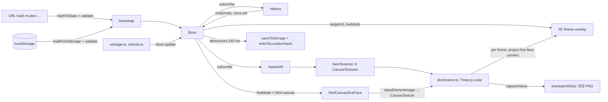

# Architecture

Cube Site is a static, client-only app: Vite builds TypeScript + Three.js into `dist/`, and there is no server or API. All state lives in the browser (memory, `localStorage`, and the URL hash).

## Components

| Module | Path | Responsibility |
|---|---|---|
| Entry | `src/main.ts` | Loads fonts and CSS, calls `bootstrap()`. |
| Bootstrap | `src/app/bootstrap.ts` | Picks the initial state (URL hash → `localStorage` → defaults), builds the stage, scene, tools and history, and wires the store subscription that repaints, syncs the iframe and persists. |
| Store + validation | `src/app/state.ts` | `AppState` type, preset table, a small pub-sub `Store`, `localStorage` load/save, and `validate()`, which repairs any state coming from an untrusted source. |
| Undo/redo | `src/app/history.ts` | Snapshots the store at the start of each burst of edits (default 600 ms idle, 60 steps). Face selection is not an undo step. |
| 3D scene | `src/dice/scene.ts` | Three.js renderer, `OrbitControls`, the cube with six `CanvasTexture` faces, the 2D `<iframe>` overlay that follows the live face, camera tweens, face picking, and off-screen capture for the photo strip. |
| Camera math | `src/dice/views.ts` | Front / overview / orbit camera positions and easing as pure functions (unit-tested without WebGL). |
| Face painter | `src/dice/faceTextures.ts` | Paints base color, stickers and imprint text for each face onto a 1024 px canvas; also paints the "style card" preview of the target site. |
| HTML-in-Canvas adapter | `src/htmlCanvas/adapter.ts` | Feature-detects `CanvasRenderingContext2D.drawElementImage`, creates a hidden `<canvas layoutsubtree>` with a live DOM child, and repaints it on `onpaint`. |
| Live-face controller | `src/htmlCanvas/liveFace.ts`, `livePanel.ts` | Turns that canvas into a `THREE.CanvasTexture` on the live face, ticks it once a second, and tears down on any error. |
| Share codec | `src/share/hash.ts` | `AppState` ↔ `#cube=<base64url(JSON)>` with shortened keys; every decode goes through `validate()`. |
| Photo strip | `src/share/printStrip.ts` | Lays out four camera captures on a 600×1800 strip and draws the footer. |
| UI | `src/ui/stage.ts`, `tools.ts`, `printPanel.ts`, `toast.ts`, `icons.ts` | Address strip with URL normalization, live-mode switch, view keys, decoration/imprint/share panels, undo/redo keys. |

## Data flow

1. On load, `bootstrap()` reads the share hash first, then `localStorage`, then `defaultState()`. Both untrusted sources pass through `validate()`.
2. UI panels call `store.update()`. Each change notifies `History`, the repaint pipeline, the iframe sync and the live-canvas controller.
3. `repaintAll()` only repaints faces whose state or theme changed.
4. Every animation frame, `syncIframeRect()` projects the live face's four corners to screen space and places the iframe over their bounding box. It hides the iframe while the user drags, while a camera tween runs, or when the face points away from the camera (`IFRAME_FACING_DOT = -0.8`).
5. Persistence is debounced 240 ms and writes both `localStorage` and the URL hash (`history.replaceState`, so it does not add history entries).

## External dependencies

- Runtime: `three` 0.171 (renderer, `OrbitControls`), `@fontsource/do-hyeon` (self-hosted display font).
- Build/test: Vite 6, TypeScript 5.7, Vitest 2 with `happy-dom`.
- Browser APIs: WebGL, `<iframe>`, Canvas 2D, Web Share API (optional), Chrome's experimental `drawElementImage` (optional, Origin Trial or flag).
- Build-time env (all optional): `TARGET_*`, `OT_TOKEN` (injected into an `origin-trial` meta tag by a Vite plugin in `vite.config.ts`), `BASE_PATH`.

## Failure handling

- **Corrupt or hostile state.** `validate()` falls back to `defaultState()` if the shape is wrong, clamps `liveFace`/`selectedFace` to 0..5, accepts only hex colors (they reach a CSS `style` string in `livePanel.ts`), and accepts only `http:`/`https:` target URLs (the value becomes `iframe.src`).
- **Sites that refuse framing.** `X-Frame-Options` / `frame-ancestors` cannot be detected reliably from the parent, so the stage shows a framing hint and the user can switch to the "스타일 카드" mode.
- **HTML-in-Canvas unavailable or failing.** `detectMode()` returns `"fallback"`, `createHtmlCanvasSource()` returns `null`, and `bootstrap` keeps the iframe visible. Any exception in setup or update triggers `teardown()` in `liveFace.ts`, which restores the painted face.
- **Storage errors.** `localStorage` quota or private-mode errors are swallowed in `saveToStorage()`; the URL hash still carries the state.
- **Cross-origin limits.** The `<base target="_self">` injection only works for same-origin targets; for others, popups open new tabs (browser security rule).

## Build and deploy

- `npm run build` → `dist/`. `BASE_PATH` sets Vite's `base` for sub-path hosting.
- `.github/workflows/pages.yml` publishes GitHub Pages from `main` with `BASE_PATH=/<repo>/`.
- `.github/workflows/ci.yml` runs typecheck, tests and the same base-path build on every pull request and on pushes to `main`.
- `vercel.json` builds the same `dist/` for the Vercel deployment.
